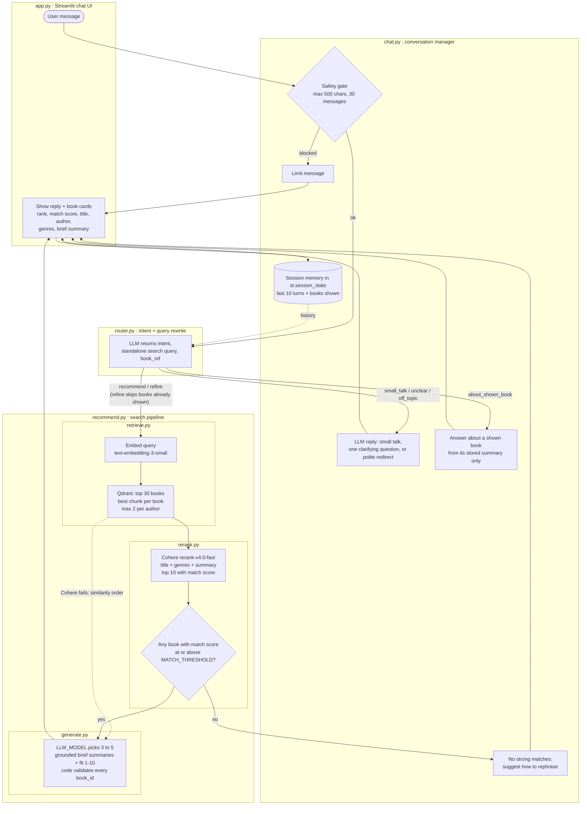

# Book Recommender

A retrieval-augmented book recommender: describe what you want to read, get 3 to 5 books from
a 12k-book dataset, reranked and summarized from the books' own stored summaries.

> Short version for now; the full README comes in a later stage.

## Query flow

Solid nodes are built. Dashed nodes would mark planned parts (none right now).

## Files in the query flow

| File | What it does in the query flow | Status |
|---|---|---|
| `app.py` | Streamlit chat UI: keeps the session in `st.session_state`, shows replies and book cards | Built |
| `src/chat.py` | Safety gate, session memory (last 10 turns), one handler per intent | Built (end-to-end run pending the smoke test) |
| `src/router.py` | One strict-JSON LLM call: intent, standalone search query, book_ref | Built (end-to-end run pending the smoke test) |
| `src/recommend.py` | Runs retrieve → rerank → threshold → generate; can exclude books already shown | Built |
| `src/retrieve.py` | Embeds the query; Qdrant top 30 books by best chunk, max 2 per author | Built |
| `src/embed.py` | `embed_texts()`, used here to embed the query | Built |
| `src/rerank.py` | Cohere rerank to a 0 to 1 match score; falls back to similarity order on failure | Built |
| `src/generate.py` | LLM picks 3 to 5 books, writes grounded summaries; code drops unknown book_ids | Built |
| `src/config.py` | Models, limits, threshold, credentials from `.env` | Built |

Offline indexing (run once, not per query): `src/load_data.py` → `src/chunking.py` →
`src/embed.py` → `src/store.py`.
